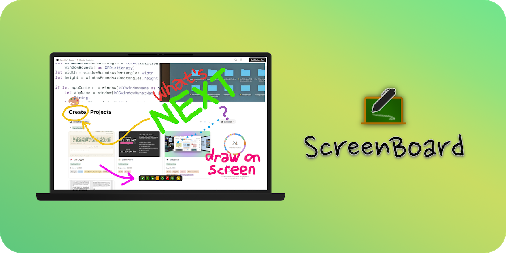

# ScreenBoard

A Qt5 cross-platform desktop whiteboard application for capturing a screen and annotating it with pens, laser pointers, erasers, colors, and adjustable stroke sizes.

## Build

**Requires:** Qt Widgets, SVG, and C++17 compiler.

In Qt Creator, open `ScreenBoard.pro`, then build and run the project.

## Technical Details

**Qt Version:** 5.15.2

**Build System:** qmake

**Compiler (Kit):** MinGW/GCC

**License:** [GNU General Public License v3.0](LICENSE)

Some icons used in ScreenBoard are modified from [Bootstrap Icons](https://icons.getbootstrap.com).